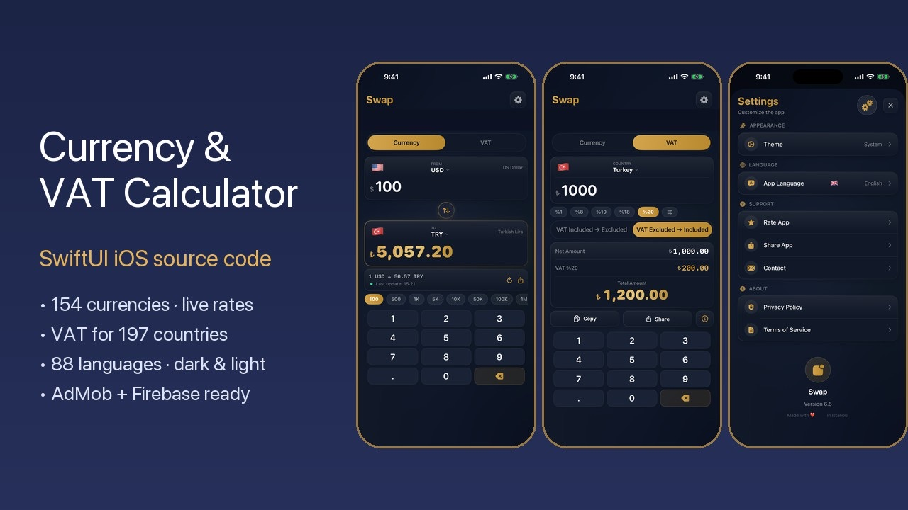
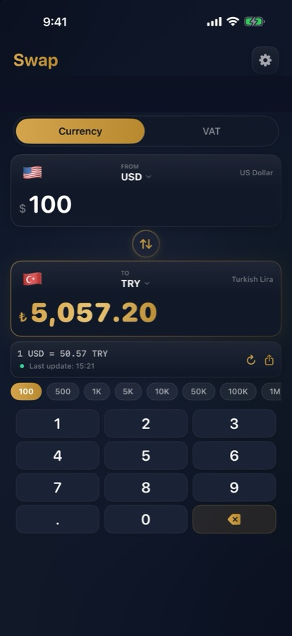
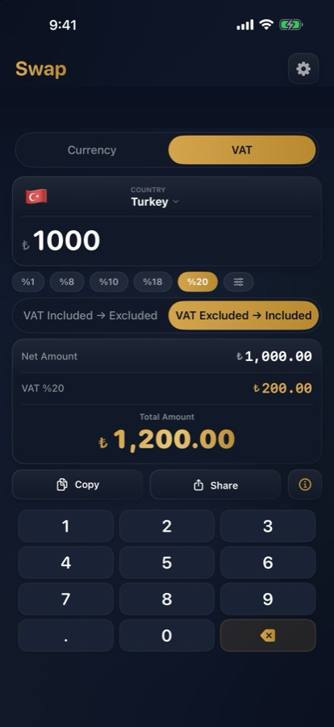
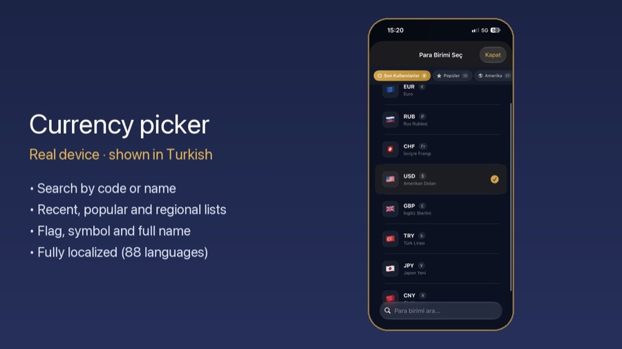
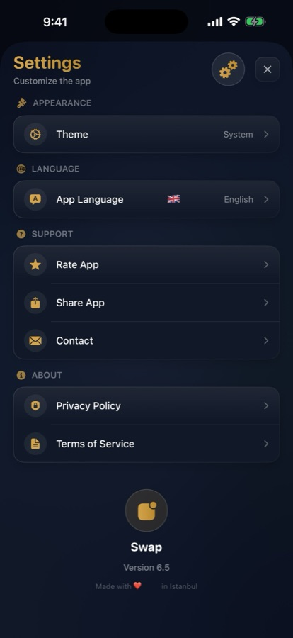

# SwiftUI Currency Converter & VAT Calculator – iOS App Source Code

**Swap+** is a live iOS currency converter and VAT calculator written in SwiftUI. It covers 154 currencies, VAT rates for 197 countries and 88 languages, and it runs in Xcode without any accounts or API keys.

**Get the source code:** [Gumroad – Currency & VAT Calculator source code](https://safakavci.gumroad.com/l/currency-vat-calculator-source)

> **This repository is a showcase only.** It contains no source code. The full source code is sold under a commercial license; the links above take you to the store page with the license terms, a demo video and the full feature list.

  
  
  
  

## Features

- Currency converter with 154 currencies and free exchange rates (no API key)
- VAT calculator with the rates of 197 countries
- Currency picker with search and favourites
- 88 languages
- Clean SwiftUI architecture, ready to rebrand

## Tech stack

Swift · SwiftUI · iOS

## More source code from the same developer

- [Flutter puzzle game source code](https://github.com/safakavciis123-netizen/flutter-puzzle-game-source-code): match-and-pop game, 2000 levels, level editor
- [Islamic prayer & Quran app source code](https://github.com/safakavciis123-netizen/islamic-prayer-quran-app-source-code): native iOS, Apple Watch, Android, Wear OS
- [Flutter recipe app source code](https://github.com/safakavciis123-netizen/flutter-recipe-app-source-code): offline, 1,610 recipes

**Keywords:** swiftui source code, currency converter app source code, vat calculator ios, ios app template, swift app source code, exchange rates app
